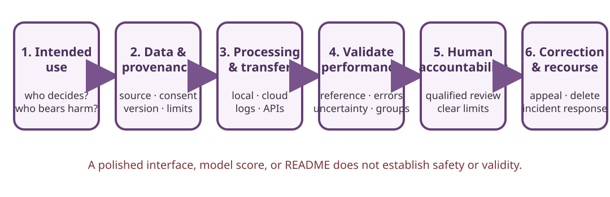

# Reviewing the Muainishi Application Series

This chapter applies an Informatics review method to William Majanja’s publicly described **Muainishi** prototypes. The project links and short descriptions below identify areas to investigate, not verified product capabilities. Repository contents, maintainers, and API behavior can change; a README, demo, or model-generated answer does not establish that an application is clinically useful, scientifically valid, private, or safe.



## 1. The projects and the review boundary

| Project | Publicly described focus | Review question before any trial |
| --- | --- | --- |
| [Muainishi Wa Jenomu](https://github.com/WilliamMajanja/Muainishi-Wa-Jenomu) | Browser-based genomics exploration, classification, and visualization; repository material mentions an external Gemini-backed analysis path. | Which sequence/metadata are collected, which processing runs in the browser, which data leaves the device, and what claims are made about ancestry or population? |
| [Muainishi Wa Viungo](https://github.com/WilliamMajanja/Muainishi-Wa-Viungo) | A concept concerning transfusion, transplant, and related biomedical information. | Which clinical workflow and authoritative source support each output, who validates compatibility, and what harm could follow an incorrect result? |
| [Muainishi Wa Saratani](https://github.com/WilliamMajanja/Muainishi-Wa-Saratani) | AI-assisted oncology classification and information support. | Is this education, research, triage, diagnosis, or treatment support? What independent validation, intended-use limit, and qualified review exist? |

This guide reviewed project descriptions and repository links, not their full source code, models, datasets, API calls, or clinical performance. Do not enter identifiable genetic, transplant, cancer, patient, or family information into a prototype. Use synthetic records only, and only in an environment that the project owner has approved for evaluation.

## 2. Map the system before discussing its output

Create a data-flow diagram with the project maintainer and a qualified data/clinical reviewer. For each step, record:

1. **Input:** files, questionnaire fields, free text, images, sequence data, or metadata accepted.
2. **Origin:** dataset owner, license, version, collection method, consent/purpose limits, and known representativeness.
3. **Processing:** browser code, server, model, third-party API, database, logs, analytics, and model/version identifiers.
4. **Output:** labels, rankings, probabilities, references, recommendations, or generated prose—and what the user may infer from each.
5. **Storage and control:** where input and output persist, who can access them, deletion/retention, backups, and key custody.
6. **Transfer:** every external request, telemetry endpoint, API provider, and jurisdictional or contract constraint.
7. **Human decision:** the qualified person responsible for review, override, correction, appeal, or rejecting the result.

A page that runs in a browser is not necessarily local-only. JavaScript can send data to a cloud service, analytics provider, or proxy. A visible API call is not the only data channel: inspect network requests, service workers, source maps, dependencies, and logging in a controlled test. Do not place real API credentials in client-side code; browser-delivered keys can be extracted by users.

## 3. Use a staged, synthetic-data assessment

### Stage A — Define intended use and stop conditions

Ask the project owner to specify what the tool is intended to do, which users and populations it covers, which decisions it must not make, its maturity/status, and how errors are reported. Set a written evaluation scope. Exclude live patients and identifiable records. Stop if the test unexpectedly transmits sensitive data, requests unnecessary credentials, or produces advice presented as authoritative clinical direction.

### Stage B — Review provenance and licenses

Record source repositories and commit/release identifiers, component licenses, dataset licenses, model/provider terms, and the intended legal basis for processing. Check whether data may be used for this purpose, whether redistribution or secondary model training is allowed, and how corrections/removals propagate to cached or derived datasets. Keep claims such as “open source,” “AI-powered,” “private,” or “research” separate from independently established facts.

### Stage C — Observe a controlled data flow

Run only in an isolated test environment using synthetic data that cannot be mistaken for a real person. Monitor browser developer tools or an approved network-observation method to inventory requests, destination domains, payload fields, cookies, local storage, and error-reporting behavior. Repeat with network access disabled if the interface claims to work offline. Record the browser, build/commit, OS, test date, expected requests, observed requests, and reviewer.

Do not intercept or probe third-party services outside the authorization. Do not submit real DNA sequences, diagnoses, or transplant details to “see whether the model works.” A synthetic fixture should be clearly artificial, carry no real identifiers, and be deleted after the test.

### Stage D — Evaluate validity and group limitations

For a classification or prediction, require an independently governed evaluation plan that identifies:

- the intended population, reference standard, inclusion/exclusion criteria, and data provenance;
- sample size, held-out test procedure, data leakage controls, and comparison baseline;
- sensitivity, specificity, calibration, false-positive/false-negative rates, uncertainty, and subgroup analysis where ethically and statistically justified;
- effects of missing, low-quality, or out-of-distribution inputs;
- versioning, reproducibility, conflict disclosures, and independent replication.

An accuracy percentage without a denominator, reference standard, population, uncertainty, and intended use is not an adequate validation claim. An ancestry estimate is not a diagnosis or a measure of a person’s worth, identity, or eligibility. A medical classifier is not a clinician.

### Stage E — Assess harm, recourse, and governance

Consider confidentiality breaches, stigma, discriminatory allocation, inappropriate treatment, denied care, family implications, and overreliance on an automated label. Define who can correct a record, contest an output, get a human review, and report harm. Set retention and deletion rules, incident contacts, audit logging, and a scheduled re-evaluation date. A demo that lacks these safeguards should stay a demo.

## 4. Project-specific questions

### Genomics exploration

Genetic data can identify a person and reveal information about relatives as well as the individual who supplied a sample. Verify sequence provenance, consent scope, database matching, family/kinship implications, data retention, and every external API transfer. Distinguish variant annotation, ancestry inference, classification, and clinical interpretation; they require different reference data and validation. Do not infer population-level truth from a small or unrepresentative reference panel.

### Transfusion and transplant information

Compatibility decisions are clinical and protocol-dependent. Identify the guideline, laboratory methods, terminology, contraindications, update process, and responsible professional behind each rule. A support tool must not replace blood-bank procedures, laboratory testing, or transplant-team approval. Test only synthetic scenarios reviewed by a qualified clinical subject-matter expert; record expected outputs before running the tool.

### Cancer information

Clarify whether the interface summarizes approved patient education, classifies an image, estimates risk, or suggests treatment. These are different intended uses. Require appropriate data governance and clinical validation for the specific population and workflow. Generated prose can sound confident while being false; provenance, uncertainty, and citations must be inspectable, and treatment decisions remain with qualified clinicians and patients through approved care pathways.

## 5. Review worksheet

Use one copy per release or evaluation:

```text
Project / repository / reviewed commit:
Date, reviewer, and written authorization:
Stated intended use and prohibited use:
Synthetic test-data description:
Input fields and source/provenance:
Observed local storage:
Observed network destinations and payload categories:
Model/provider and version (if present):
Validation evidence and known limitations:
Human owner, correction route, and incident contact:
Retention/deletion plan:
Unexpected behavior / stop condition triggered:
Disposition: demo only / further review / approved limited use:
Approver and next review date:
```

Keep test artifacts separate from operational records. Redact internal addresses and credentials before sharing the worksheet. A completed review records what was examined; it does not certify the software or establish medical-device compliance.

## Sources and status

- [Muainishi Wa Jenomu repository](https://github.com/WilliamMajanja/Muainishi-Wa-Jenomu)
- [Muainishi Wa Viungo repository](https://github.com/WilliamMajanja/Muainishi-Wa-Viungo)
- [Muainishi Wa Saratani repository](https://github.com/WilliamMajanja/Muainishi-Wa-Saratani)
- [WHO: Ethics and governance of artificial intelligence for health](https://www.who.int/publications/i/item/9789240029200)
- [NIST AI Risk Management Framework](https://www.nist.gov/itl/ai-risk-management-framework)
- [UNICEF Policy on Personal Data Protection](https://www.unicef.org/about-us/personal-data-protection)

**Evidence limit:** repository descriptions are source claims, not independent source-code, privacy, security, or clinical validation. Check each current commit and all applicable local rules before any use.
