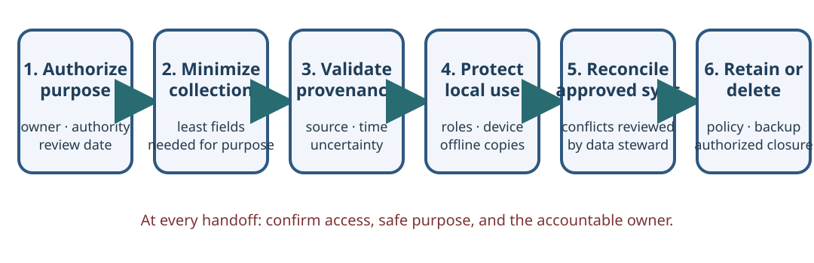

# Data Stewardship for Field Information Systems

This chapter is for technical operatives who maintain devices and workflows used by humanitarian, peace-support, mine-action, health, and community teams. It is about safe information systems, not authority to collect case data or make operational decisions. The responsible organization, affected people, data controller, and qualified domain specialists define the purpose and rules.

## 1. Begin with purpose and authority

Before collecting, importing, exporting, or syncing a dataset, record:

1. **Purpose:** Which concrete service or decision needs the data? Can it work with less detail or with an aggregate?
2. **Authority:** Who is responsible for collection, access, correction, disclosure, retention, and deletion? Which policy and local law apply?
3. **People and impact:** Who is represented, who could be harmed by exposure or error, and what safe participation or consent process applies?
4. **System boundary:** Which devices, users, offline copies, networks, APIs, backups, and receiving organizations will handle the data?
5. **End of use:** What is the review date, retention trigger, and approved deletion or archive process?

If the owner cannot answer these questions, do not create a new database “just in case.” Escalate to the designated information manager, protection focal point, or data-protection role. A technically encrypted or offline system can still be unauthorized, inaccurate, or unsafe.

## 2. Classify and minimize

Use the organization’s existing classification scheme. If none is available, do not invent labels that imply legal approval; ask the responsible authority to define handling rules. As a temporary planning exercise, list broad sensitivity groups such as public material, internal operational data, personal data, and restricted case data, then obtain approval for the actual controls.

For each field, ask whether it is necessary to the stated purpose, who needs it, how precise it must be, and when it can be removed. Avoid collecting names, precise coordinates, phone numbers, biometrics, health details, or case narratives unless the approved workflow requires them. Re-identification can occur by combining fields that appear anonymous in isolation. Aggregation and removing direct identifiers reduce risk but do not guarantee anonymity.

Separate technical diagnostics from the case record. A support ticket usually needs a device identifier, time, symptom, OS version, and troubleshooting result—not the beneficiary’s case details or the full operational map. Do not paste protected information into public issue trackers, screenshots, analytics dashboards, AI prompts, or ordinary email.

## 3. Preserve provenance and data quality

Keep the origin and meaning of records visible. An approved record should identify the source role or system, collection time and time zone, schema/version, method, validation status, uncertainty, authorized corrections, and relevant unit or coordinate reference. Record provenance without exposing a reporter’s identity to users who do not need it.

Distinguish at least:

- an observation from a report by another person;
- an unverified report from a validated record;
- a blank value from “no,” “not applicable,” “unknown,” or “not collected”;
- a correction from an overwrite that erases the previous value;
- a device clock timestamp from an independently verified event time.

Use controlled vocabularies and schema definitions maintained by the responsible domain team. Validate required fields, ranges, allowed categories, duplicate identifiers, date order, and coordinate reference using synthetic or approved test data. A validation rule can detect format errors; it cannot establish that the underlying report is true.

## 4. Design offline-first operation without creating conflicting truth

Offline access can keep a service available in low-connectivity settings, but every local copy increases the number of places requiring protection and reconciliation.

Before a deployment:

- identify which data must be available offline and which functions can wait;
- limit each device to the minimum dataset needed for its role and area;
- document who may unlock, update, transfer, or wipe it and how loss is reported;
- encrypt storage and backups only through a reviewed, supported design with tested key recovery;
- define a synchronization window, approved network, receiving system, and failure path;
- test against synthetic records, including interrupted transfers and duplicate submissions.

Do not use “last write wins” as a universal conflict policy. A newer timestamp may come from a device with an incorrect clock; an automatic merge may erase a specialist’s correction or reveal data to an unauthorized user. Assign a qualified data steward to review conflicts, retain an auditable history, and resolve them according to the data owner’s rules. Make retries idempotent where the approved software permits: submitting the same record twice should not silently create two cases or two actions.

Never use a consumer messaging account or removable drive as an improvised synchronization system for protected data. If approved portable media is necessary, document custody, encryption, transfer, receipt, verification, and deletion of temporary copies.

## 5. Roles, access, and disclosure

Grant the least access needed for a person’s assigned task. Separate system administration from case review where feasible. Test access using accounts and synthetic fixtures that represent each role; verify both that permitted work functions and that prohibited records remain inaccessible. Review access after role changes, deployments, incidents, and the organization’s scheduled interval.

Maintain an approved audit trail for access, export, correction, and administrative actions while minimizing the sensitive content written into the log. Logs themselves require access controls and retention rules. Do not promise a user complete confidentiality or anonymity unless the complete technical and operational design supports that promise.

For release outside the original team, confirm the authority, purpose, recipient, legal basis/policy, minimum fields, aggregation threshold, secure transfer route, and retention expectation. Ask a specialist to assess re-identification and retaliation risk before publishing maps or small-area statistics. A dashboard’s “export” button is not authorization to disclose.

## 6. Retention, backup, and incident response

For each data class, document the owner, backup frequency, protected destination, retention, restore test, and deletion/archival authority. Ensure offline copies, removable media, caches, printouts, and vendor backups are included. Backups can preserve an unauthorized record after the live record has been deleted; deletion needs a lifecycle plan.

If a device or copy is lost, sent to the wrong recipient, or accessed unexpectedly:

1. protect people first and contact the designated incident lead;
2. record the device, data categories, time, custody, and observed facts without speculating;
3. use approved revocation, isolation, remote-lock, or notification procedures—do not improvise actions that could destroy evidence;
4. preserve relevant logs and coordinate specialist/legal/Protection notification under policy;
5. review affected users and data subjects through the responsible channels;
6. document remediation, lessons, and the authority that closes the incident.

Do not independently contact a child, survivor, patient, community reporter, or alleged perpetrator about a suspected data incident. Use designated protection and incident-response roles.

## 7. Worked synthetic example: offline referral register

An approved local health partner needs to see whether a referral was received during a connectivity outage. The IT support worker does not need the case narrative. Work with the data owner to define a synthetic demonstration record containing a random test ID, referral status, date, and responsible service role. Test that:

- a user sees only the records required for their role;
- the local queue displays a clear “not yet synchronized” state;
- retrying the transfer does not duplicate the referral;
- two edits produce a visible conflict for authorized review rather than silent overwrite;
- the receiving system acknowledges the record before the local queue marks it complete;
- the demonstration data can be cleared and the test account disabled.

This exercise tests interface and workflow behavior only. It does not validate clinical decisions, consent, legal basis, safety of a live referral, or the system’s overall security.

## Field review checklist

Before deployment or change, confirm purpose, authority, minimum fields, user roles, data flow, offline-copy count, synchronization/conflict process, backup/restore, retention/deletion, incident contact, specialist approval, and a synthetic-data test. Record unresolved issues with an owner and review date; do not mark the system “safe” merely because each technical box was checked.

## References

- [IMAS 05.10: Information management for mine action](https://www.mineactionstandards.org/standards/05-10/)
- [IMAS 07.14: Risk management in mine action](https://www.mineactionstandards.org/standards/07-14/)
- [UNICEF Policy on Personal Data Protection](https://www.unicef.org/about-us/personal-data-protection)
- [OCHA Data Responsibility Guidelines](https://centre.humdata.org/data-responsibility/)
- [ICRC Handbook on Data Protection in Humanitarian Action](https://www.icrc.org/en/data-protection-humanitarian-action-handbook)
