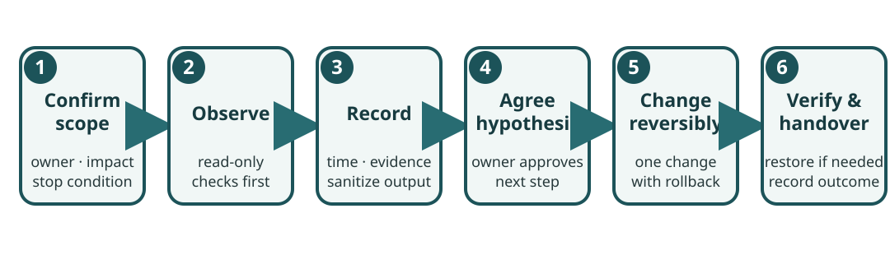

# Secure Baselines and Routine Maintenance

This chapter turns a newly installed Raspberry Pi into a supportable service. Apply changes only with the device owner’s approval. The exact controls depend on the installed OS, service purpose, physical site, and organizational policy; a checklist is not a security certification.



## 1. Record the intended state

Before applying security settings, write down:

- the device owner, service owner, purpose, location category, and authorized administrators;
- board model/revision, OS and image release, architecture, kernel, boot and storage media;
- data classes held locally, expected network paths, exposed services, and remote access method;
- maintenance contact, recovery route, backup location, and stop/escalation conditions.

Use a unique hostname and an inventory identifier that does not expose a person’s name, mission, or sensitive location. Store detailed asset records under the organization’s access policy. Compare the intended design with the actual device; do not silently redefine “normal” from whatever happens to be installed.

## 2. Review users and credentials

List the accounts and administrative groups through an approved local session. For each account, confirm a named owner, a necessary role, and a removal or review date. Shared administrator accounts make accountability and safe offboarding difficult. Do not send passwords, private keys, recovery codes, or reset links in a support ticket.

Use unique credentials for each device or managed identity. Prefer an approved central identity or credential-management system where available. If the device is offline, define secure enrollment, recovery, rotation, and staff-departure procedures before deployment. Do not invent a universal default password for a fleet.

For SSH, first confirm the authorized network path and a working local recovery route. Use the distribution’s supported SSH configuration. Public-key authentication can reduce password exposure, but key files and authorized-key lists still require owner, storage, rotation, and revocation controls. Never disable password login remotely until a verified replacement key works in a second session and the owner has approved the change.

Before an approved SSH configuration change, back up the existing file with restricted permissions, validate syntax, and confirm the service’s listening address and firewall path. A failed remote change can lock out the only support route. Raspberry Pi OS and general Debian images may differ in defaults; inspect the active configuration rather than assuming a setting from a tutorial applies.

## 3. Minimize services and network exposure

Inventory listening sockets and enabled services from the local device:

```bash
ss -lntup
systemctl --type=service --state=running --no-pager
systemctl --failed --no-pager
```

Some process details require elevated access; do not elevate automatically. Match each service to a documented purpose and owner. A listening socket is evidence that a process accepts a local network connection, not proof that it is reachable from outside the device. Reachability also depends on address binding, host firewall, network controls, VPN, and upstream routing.

Disable or remove a service only when its owner confirms it is unnecessary and a rollback plan exists. Avoid exposing SSH, VNC, dashboards, development servers, or CPIP directly to the public internet. Use the organization’s approved VPN or managed support gateway, MFA where available, and a restricted management network. Never scan neighboring devices as a substitute for checking the Pi’s own configuration.

## 4. Keep updates predictable

Agree on an update owner and maintenance cadence. Before a change, review the OS release policy, vendor advisories, package source, available disk space, backup status, maintenance window, and rollback path. For high-impact devices, rehearse the process on a representative spare unit. Record the current package/kernel state and the exact command or image used.

Apply the installed distribution’s update instructions only. Raspberry Pi OS, Debian stable, and Kali rolling have different repositories, firmware behavior, support windows, and service defaults. Never mix repositories. For a production system, inspect proposed package removals and configuration prompts and obtain approval; do not use unattended confirmation flags on an unfamiliar machine.

After updates, verify at least: boot completion, expected network path, time synchronization where available, required service status, application-level behavior, log errors, backup job status, and a clean shutdown/restart path. Record any change that remains unresolved.

## 5. Protect physical and power reliability

Match the supply, cable, enclosure, cooling, and peripherals to the exact board and workload. Label the device and power supply together. Secure equipment against accidental disconnection, moisture, dust, heat, unauthorized access, and theft in ways suitable to the site. Do not improvise mains wiring or place exposed boards where conductive objects can bridge contacts.

For intermittent power, use the organization’s approved UPS or shutdown design and test it under controlled conditions. A battery indicator or “clean” journal alone does not prove that application data is consistent. Confirm database/application-level backup and recovery behavior with the service owner. Have a documented response when power, connectivity, or a spare part is unavailable.

## 6. Example maintenance cycle

| When | Check | Record and action |
| --- | --- | --- |
| At handover | Owner, purpose, accounts, services, storage, approved network, backup, recovery contact | Baseline record and signed acceptance by the responsible roles |
| Before each change window | Advisory/release notes, free space, backup age, impact, rollback and contact | Approved plan, start time, expected result, stop condition |
| After each change | Boot, service state, logs, network path, user task, backup status | Actual result, errors, residual risks, owner acceptance |
| On the agreed schedule | Restore test, account review, spare media, physical condition, documentation age | Test evidence, assigned repair/review date |
| At retirement or loss | Access revocation, data retention/disposal, incident and asset records | Authorized closure; preserve evidence if required by policy |

Choose intervals with the service owner and applicable policy; these categories are a planning aid, not a universal schedule.

## 7. Escalate safely

Stop and involve the service owner or specialist when a proposed step may destroy data, interrupt a safety-critical or humanitarian service, expose protected records, lock out administrators, or exceed the authorized support scope. Preserve relevant logs and device state when an incident is suspected. Do not “fix first and document later” if that could erase evidence or create unapproved risk.

For a security finding, use the [authorized assessment playbook](Security_Assessment_Playbook.md). For storage, package, and restore work, use [Linux recovery procedures](../0.%20Linux%20Foundations/Storage_Packages_and_Recovery.md).

## References

- [Raspberry Pi operational security](https://www.raspberrypi.com/documentation/security/operational-security.html)
- [Raspberry Pi remote access](https://www.raspberrypi.com/documentation/computers/remote-access.html)
- [Raspberry Pi power supply guidance](https://www.raspberrypi.com/documentation/computers/getting-started.html#power)
- [Debian security information](https://www.debian.org/security/)
- [Debian Administrator’s Handbook](https://www.debian.org/doc/manuals/debian-handbook/)
